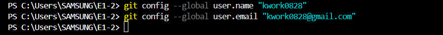
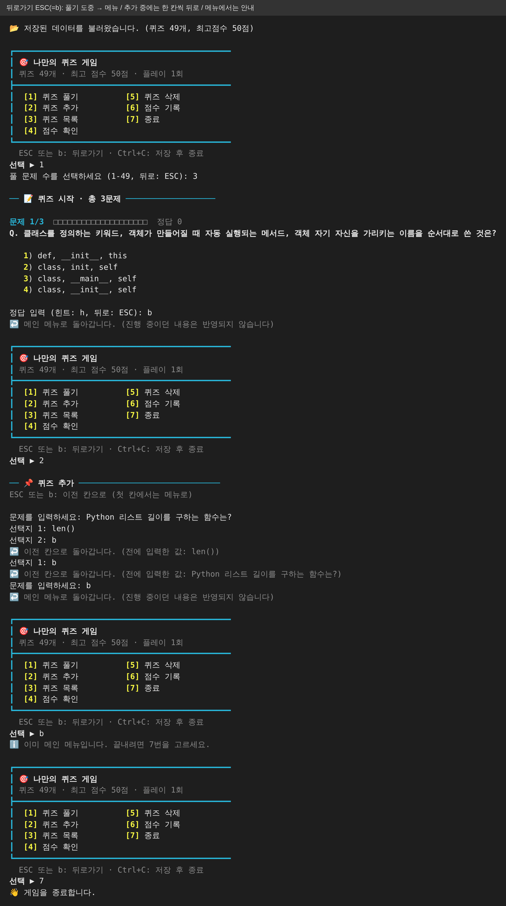

# 🎯 나만의 퀴즈 게임 (E1-2)

터미널에서 동작하는 **Python 콘솔 퀴즈 게임**입니다. 메뉴에서 번호를 고르면 퀴즈 풀기/추가/목록/점수 확인/삭제/기록이 동작하고,
프로그램을 종료해도 **추가한 퀴즈와 최고 점수가 `state.json`에 남습니다.** 어느 화면에서든 `ESC` 키(또는 `b`)를 누르면 한 단계 뒤로 돌아갑니다.

> 각 장 끝의 **🎤 설명 노트**를 펼치면, 그 장을 화면에 띄워 놓고 말할 설명과 관련 코드 해설이 나옵니다.

## 목차
1. [프로젝트 개요](#1-프로젝트-개요) · 2. [퀴즈 주제 선정 이유](#2-퀴즈-주제-선정-이유) · 3. [실행 방법](#3-실행-방법) · 4. [기능 목록](#4-기능-목록)
5. [파일 구조](#5-파일-구조) · 6. [데이터 파일(state.json)](#6-데이터-파일-statejson-설명) · 7. [코드 설계](#7-코드-설계-클래스와-함수) · 8. [입력/예외 처리](#8-입력예외-처리)
9. [실행 화면](#9-실행-화면) · 10. [Git 작업 과정](#10-git-작업-과정) · 11. [요건 충족 체크리스트](#11-요건-충족-체크리스트) · 12. [설계하며 고민한 점](#12-설계하며-고민한-점) · 13. [개념 정리](#13-배운-개념-정리)

---

## 1. 프로젝트 개요
- **목표:** Python 기본 문법(입출력, 조건, 반복, 함수, 클래스, 파일 입출력, 예외 처리)으로 동작하는 프로그램을 처음부터 끝까지 만들고, Git으로 기능 단위 이력을 남긴다.
- **개발 환경:** Python 3.10 이상, **외부 라이브러리 없이 표준 라이브러리만 사용** (`json`, `os`, `random`, `datetime`, `pathlib`). 사용 버전은 [`docs/logs/env.log`](docs/logs/env.log) 참고.
- **보너스(5개 모두 구현):** 랜덤 출제, 문제 수 선택, 힌트(+감점), 퀴즈 삭제, 점수 기록 히스토리.
- **추가 기능:**
  - 어느 입력 화면에서든 `ESC` 키(또는 `b` 입력)로 **한 단계 뒤로가기**: 퀴즈 추가 중에는 이전 칸으로, 풀기·삭제 중에는 메인 메뉴로
  - **화면 개선:** 색상(정답 초록·오답 빨강·힌트 노랑), 테두리 메뉴(두 칸 배치 + 퀴즈 수·최고 점수 상태 줄), 문제 진행 막대 `■■■□□□`, 결과 상자. 직접 실행할 때는 기능이 끝나면 Enter 후 화면을 지우고 메뉴를 새로 그립니다.

### 개발 환경 설정 (Windows PC, VSCode 터미널 PowerShell)
| 항목 | 확인 명령 | 결과 |
|---|---|---|
| Python 버전 | `python -V`, `python --version` | Python 3.15.2 |
| Git 버전 | `git --version` | git version 2.56.0.windows.4 |
| Git 사용자 설정 | `git config --global user.name` / `user.email` | kwork0828 / kwork0828@gmail.com |

**Git 사용자 설정** (이 PC에서 커밋할 때 기록될 이름과 이메일 지정)


<details>
<summary>🎤 설명 노트</summary>

**말할 내용**
> 제가 만든 것은 터미널에서 돌아가는 파이썬 퀴즈 게임입니다. 메뉴에서 번호를 고르면 퀴즈 풀기, 추가, 목록, 점수 확인, 삭제, 기록, 이렇게 여섯 가지 기능이 동작하고, 프로그램을 껐다 켜도 추가한 퀴즈와 최고 점수가 그대로 남습니다.
>
> 외부 라이브러리 없이 파이썬 표준 라이브러리만 썼고, Git으로 기능 단위 이력을 남겼습니다. 보너스 다섯 개도 모두 구현했고, 어느 화면에서든 b를 누르면 메뉴로 돌아가는 뒤로가기와, 색상과 진행 막대로 보기 좋게 만든 화면도 추가했습니다.

**이해 포인트: 표준 라이브러리 5개가 쓰인 곳**

| 모듈 | 하는 일 | 쓰인 곳 |
|---|---|---|
| `json` | 딕셔너리/리스트를 파일로 저장·불러오기 | `save()`, `load()` |
| `os` | 파일 교체 (`os.replace`) | 안전 저장 |
| `random` | 중복 없이 무작위로 고르기 (`random.sample`) | 랜덤 출제 |
| `datetime` | 현재 날짜·시간 | 점수 기록 `played_at` |
| `pathlib` | 파일 경로 다루기 | `STATE_PATH` |
| `sys`, `unicodedata` | 터미널인지 확인, 한글 글자 폭 계산 | `ui.py` (색상 켜기/끄기, 메뉴 정렬) |

**프로그램의 큰 흐름:** `main.py 실행 → load(): state.json 읽기 → run(): 메뉴 반복 → 기능 실행 → 종료 시 save()`
이 프로그램은 "불러오기 → 메뉴 반복 → 저장" 세 덩어리이고, 나머지는 전부 이 안의 세부 기능입니다.
</details>

---

## 2. 퀴즈 주제 선정 이유
주제는 **「2주차 시험 대비 (Python · 예외 · 클래스 · JSON · Git · Docker 복습)」** 입니다.
1. 2주차 시험 공부 자료([`docs/week2_study.md`](docs/week2_study.md))의 개념마다 한 문제씩 만들어, 퀴즈를 풀면서 시험 범위를 복습할 수 있습니다.
2. 정답이 자료에 분명히 나와 있어 4지선다로 만들기 좋습니다.
3. 문제마다 힌트를 "동료에게 말로 설명할 때 쓸 한 문장"으로 써서, 동료평가 때 설명 연습도 됩니다.
4. 기본 49문제 외에 사용자가 자기 주제 퀴즈를 직접 추가할 수 있어, 다른 주제로도 확장됩니다.

<details>
<summary>🎤 설명 노트</summary>

**말할 내용**
> 주제는 2주차 시험 대비입니다. 파이썬, 예외 처리, 클래스, JSON, 깃, 도커까지 이번 주에 배운 범위를 퀴즈로 만들었습니다.
>
> 이유는 세 가지입니다. 공부 자료의 개념마다 한 문제씩 만들어서 게임을 하면서 시험 범위를 한 바퀴 복습할 수 있고, 정답이 자료에 분명히 나와 있어서 4지선다로 만들기 좋았고, 힌트를 동료에게 설명할 때 쓸 한 문장으로 적어 두어서 설명 연습도 됩니다. 기본 문제는 49개이고, 메뉴에서 다른 주제 퀴즈를 직접 추가할 수도 있습니다.

**이해 포인트: 49문제는 `default_data.py`에 이런 모양으로 들어 있습니다**
```python
{"question": "사용자가 숫자 5를 입력했을 때 input() 이 돌려주는 값의 자료형은?",
 "choices": ["int (정수)", "float (실수)", "str (문자열)", "bool (참/거짓)"],
 "answer": 3,
 "hint": "키보드로 친 것을 프로그램이 처음에 어떤 형태로 받는지 설명해 보세요."}
```
정답 `3`은 세 번째 선택지 "str"입니다. 정답 번호는 0이 아니라 **1부터** 셉니다.
</details>

---

## 3. 실행 방법
```bash
git clone https://github.com/kwork0828/E1-2.git
cd E1-2
python main.py        # Windows는 python, macOS/Linux는 python3
```
- 처음 실행하면 `state.json`이 없으므로 기본 퀴즈 49개로 시작하고, 종료할 때 `state.json`이 자동 생성됩니다.
- `state.json`이 이미 있으면 그 파일을 읽어 이어서 합니다. 예전 버전 기본 문제로 저장된 파일이면 **기본 문제만 자동으로 새 버전으로 교체**하고, 직접 추가한 퀴즈·최고 점수·기록은 그대로 둡니다. 따로 파일을 지울 필요가 없습니다.
- 한 단계 뒤로 가려면 `ESC`(또는 `b` + Enter), 프로그램을 끝내려면 메뉴 `7. 종료` 또는 `Ctrl+C`(저장 후 안전 종료).

<details>
<summary>🎤 설명 노트</summary>

**말할 내용**
> 실행은 간단합니다. 저장소를 clone 받고 `python main.py`를 치면 메뉴가 나옵니다. 처음 실행하면 저장 파일이 없으니 기본 문제 49개로 시작하고, 종료할 때 저장 파일이 만들어집니다. 그다음부터는 그 파일을 읽어서 이어서 합니다.

**이해 포인트: `main.py` 전체**
```python
from quiz_game import QuizGame

def main() -> None:
    QuizGame.load().run()

if __name__ == "__main__":
    main()
```
- `QuizGame.load()`가 저장 파일을 읽어 게임 객체를 만들고, `.run()`이 메뉴 반복을 시작합니다.
- `if __name__ == "__main__":`은 "이 파일을 직접 실행했을 때만 `main()`을 부르라"는 뜻입니다.
</details>

---

## 4. 기능 목록
| 메뉴 | 기능 | 핵심 동작 |
|---|---|---|
| 1 | 퀴즈 풀기 | 풀 문제 수 선택 → **랜덤** 순서로 출제 → 정답 입력 → 정오답 안내 → 결과/최고 점수 갱신 (`h` 입력 시 **힌트**, 그 문제 배점 절반) |
| 2 | 퀴즈 추가 | 문제, 선택지 4개, 정답 번호(1~4) 입력 → **추가 즉시** 파일에 저장 |
| 3 | 퀴즈 목록 | 등록된 퀴즈를 번호와 함께 표시 (없으면 안내) |
| 4 | 점수 확인 | 저장된 **최고 점수** 표시 (아직 안 풀었으면 안내) |
| 5 | 퀴즈 삭제 | 번호로 삭제, 0은 취소, 즉시 파일 반영 |
| 6 | 점수 기록 | 모든 게임의 날짜/시간, 푼 문제 수, 정답 수, 점수 |
| 7 | 종료 | 저장 후 종료 |
| `ESC` / `b` | 뒤로가기 | **한 단계 뒤로.** 퀴즈 추가 중에는 이전 입력 칸으로(전에 쓴 값을 보여줌), 풀기·삭제 중에는 메인 메뉴로(진행 중이던 게임은 기록하지 않음), 메뉴에서는 안내만 |

**화면 구성:** 메뉴는 테두리 상자 안에 두 칸으로 배치하고, 위쪽 상태 줄에 퀴즈 수·최고 점수·플레이 횟수를 보여줍니다. 문제마다 `문제 2/5 ■■■■□□□□` 진행 막대가 나오고, 정답은 초록·오답은 빨강·힌트는 노랑으로 표시됩니다. 직접 실행할 때는 기능이 끝나면 `Enter`를 누른 뒤 화면을 지우고 메뉴를 새로 그립니다.

**점수 규칙:** 문제당 배점 = 100 ÷ 푼 문제 수. 힌트를 보고 맞히면 그 문제는 절반만 받습니다. 최종 점수는 반올림한 100점 만점이라 푼 문제 수가 달라도 최고 점수를 서로 비교할 수 있습니다.
예) 3문제 중 힌트 쓰고 1개 정답, 그냥 1개 정답, 1개 오답 → 33.3 × 0.5 + 33.3 = **50점**

**시연용 예시 데이터**

| 시연 | 입력 예시 |
|---|---|
| 퀴즈 추가 | 문제 `Git에서 새 브랜치를 만들면서 바로 그 브랜치로 이동하는 명령은?` / 선택지 `git branch -d`, `git checkout -b`, `git merge`, `git log` / 정답 `2` |
| 퀴즈 추가 (Python) | 문제 `Python 리스트의 길이를 구하는 함수는?` / 선택지 `size()`, `count()`, `len()`, `length()` / 정답 `3` |
| 퀴즈 추가 (예외) | 문제 `int("abc") 를 실행하면 발생하는 예외는?` / 선택지 `KeyError`, `ValueError`, `TypeError`, `IndexError` / 정답 `2` |
| 퀴즈 삭제 | 방금 추가한 문제(목록 맨 끝, 50번)를 삭제 → 목록에서 사라지고 다시 49개 |
| 삭제 취소 | 삭제 번호에 `0` → "삭제를 취소했습니다" |
| 뒤로가기 | 퀴즈 추가 중 선택지 2 칸에서 `ESC` → 선택지 1 칸으로 돌아감, 계속 누르면 문제 칸 → 메뉴 |

<details>
<summary>🎤 설명 노트</summary>

**말할 내용**
> 가장 핵심인 퀴즈 풀기를 보여드리겠습니다. 먼저 풀 문제 수를 고르면, 전체 문제에서 중복 없이 무작위로 그만큼 뽑아 출제합니다.
>
> 문제에서 h를 입력하면 힌트가 나오고, 대신 이 문제는 배점이 절반으로 줄어듭니다. 틀리면 정답이 몇 번인지 알려줍니다.
>
> 점수는 문제당 100점을 문제 수로 나눈 값입니다. 3문제면 문제당 약 33점이고, 힌트를 쓴 문제는 약 17점입니다. 그래서 힌트 쓰고 하나, 그냥 하나 맞히면 50점입니다. 100점 만점으로 환산하기 때문에 문제 수가 달라도 최고 점수를 비교할 수 있습니다. 끝나면 결과를 기록에 남기고 바로 파일에 저장합니다.
>
> 그리고 풀다가 그만두고 싶으면 ESC를 누르면 됩니다. 그 게임은 기록되지 않고 바로 메뉴로 돌아갑니다. 퀴즈를 추가할 때는 ESC를 누를 때마다 한 칸씩 이전 입력으로 돌아갑니다.

**이해 포인트: 점수 계산 (`quiz_game.py`의 `play`)**
```python
selected = random.sample(self.quizzes, count)   # 중복 없이 count개 뽑기
per_question = 100 / total                      # 문제당 배점

if quiz.is_correct(user_answer):
    correct += 1
    earned += per_question * (0.5 if used_hint else 1)

score = round(earned)                           # 반올림해서 정수 점수
if self.best_score is None or score > self.best_score:
    self.best_score = score                     # 최고 점수 갱신
```
`(0.5 if used_hint else 1)`은 "힌트를 썼으면 0.5, 아니면 1"입니다.

**이해 포인트: 힌트 입력**
```python
user_answer = ask_int("정답 입력 (힌트: h, 뒤로: b): ", 1, 4, allow=("h",))
if user_answer == "h":
    print("💡 힌트: ...")
    used_hint = True
    continue            # 같은 문제를 다시 묻는다
```
`ask_int`는 원래 숫자만 받는데, `allow=("h",)`로 h만 통과시킵니다.
</details>

---

## 5. 파일 구조
```text
E1-2/
├── main.py            # 진입점: 저장된 데이터를 불러와 게임 실행
├── quiz.py            # Quiz 클래스 (퀴즈 1개: 문제/선택지4/정답/힌트)
├── quiz_game.py       # QuizGame 클래스 (메뉴, 풀기/추가/목록/점수/삭제/기록, 저장/불러오기)
├── inputs.py          # 입력 검증 함수 (ask, ask_text, ask_int), ESC 키 읽기 + GoBack/QuitGame 예외
├── ui.py              # 화면 꾸미기: 색상, 테두리, 진행 막대, 화면 지우기
├── default_data.py    # 기본 퀴즈 49개: 2주차 시험 대비 (Quiz 인스턴스로 생성)
├── state.json         # (실행 시 자동 생성, git 제외) 퀴즈 + 최고 점수 + 기록
├── tools/make_screenshots.py   # 실행 화면을 PNG로 만드는 도구
├── docs/screenshots/  # 실행 화면 PNG        ├── docs/demo/   # 같은 화면의 원본 텍스트
└── docs/logs/         # 환경/clone·pull 실습 로그
```

<details>
<summary>🎤 설명 노트</summary>

**말할 내용**
> 파일은 역할별로 나눴습니다. `main.py`는 시작점이고 두 줄뿐입니다. `quiz.py`는 퀴즈 한 개, `quiz_game.py`는 메뉴와 기능을 담은 게임 전체, `inputs.py`는 입력 검증, `default_data.py`는 기본 문제 49개입니다. `state.json`은 실행하면 만들어지는 저장 파일이고, 계속 바뀌는 사용자 데이터라 깃에는 올리지 않았습니다.

**이해 포인트: 비유로 기억하기**

| 파일 | 비유 |
|---|---|
| `quiz.py` | 문제 카드 한 장 (문제, 보기 4개, 정답) |
| `quiz_game.py` | 카드 묶음을 들고 진행하는 사회자 |
| `inputs.py` | 이상한 입력을 걸러내는 문지기 |
| `ui.py` | 화면을 꾸미는 무대 조명 (색, 테두리, 진행 막대) |
| `default_data.py` | 처음 주는 기본 카드 49장 |
| `state.json` | 게임 중 바뀐 내용을 적어 두는 저장 노트 |
</details>

---

## 6. 데이터 파일 (`state.json`) 설명
- **경로:** 프로젝트 루트 `state.json` (코드 위치 기준이라 어느 폴더에서 실행해도 같은 파일)
- **역할:** 프로그램을 종료해도 퀴즈와 최고 점수가 남도록 하는 저장소 (UTF-8, 한글 그대로 저장)
- **스키마:**

| 키 | 타입 | 설명 |
|---|---|---|
| `default_version` | int | 기본 문제 세트 버전(현재 2). 예전 파일에는 없으며, 없거나 낮으면 기본 문제를 자동 교체 |
| `quizzes` | list | 퀴즈 목록. 각 항목은 `question`(str), `choices`(str 4개 리스트), `answer`(int, **1~4 번호**), `hint`(선택, str) |
| `best_score` | int 또는 null | 최고 점수(0~100). 아직 안 풀었으면 `null` |
| `history` | list | 보너스. `played_at`, `total`, `correct`, `score` (이 키가 없는 예전 파일도 읽힘) |

```json
{
  "default_version": 2,
  "quizzes": [
    {"question": "Python의 창시자는?", "choices": ["Guido van Rossum", "Linus Torvalds", "Bjarne Stroustrup", "James Gosling"], "answer": 1, "hint": "네덜란드 출신 프로그래머입니다. 이름이 G로 시작해요."}
  ],
  "best_score": 50,
  "history": [{"played_at": "2026-11-07 07:05:36", "total": 3, "correct": 2, "score": 50}]
}
```
- **왜 JSON인가:** 리스트/딕셔너리 구조가 그대로 파일이 되고, 사람이 읽고 고칠 수 있으며, Python 표준 `json` 모듈만으로 충분합니다.
- **`state.json`을 git에 올리지 않는 이유:** 실행하면 계속 바뀌는 사용자 데이터라 커밋이 지저분해지기 때문입니다. 파일이 없으면 기본 데이터로 시작하므로 재현에는 문제가 없습니다.
- **안전 저장:** 임시 파일에 먼저 쓰고 `os.replace`로 교체합니다. 저장 도중 끊겨도 원본이 반쯤 쓰인 채 깨지지 않습니다.

<details>
<summary>🎤 설명 노트</summary>

**말할 내용**
> 프로그램을 껐다 켜도 데이터가 남는 이유는 `state.json`에 저장하기 때문입니다. 이 파일에는 퀴즈 목록, 최고 점수, 게임 기록 세 가지가 들어 있습니다. JSON을 쓴 이유는 파이썬의 리스트와 딕셔너리가 거의 그대로 파일이 되고, 사람이 열어서 읽을 수 있고, 표준 라이브러리만으로 충분하기 때문입니다.
>
> 저장할 때는 먼저 임시 파일에 쓰고 나서 원래 파일과 바꿔치기합니다. 쓰는 도중에 끊겨도 원본이 깨지지 않게 하기 위해서입니다.

**이해 포인트: 저장 (`save`)**
```python
tmp = path.with_suffix(".json.tmp")
with open(tmp, "w", encoding="utf-8") as f:
    json.dump(self.to_state(), f, ensure_ascii=False, indent=2)
os.replace(tmp, path)      # 다 쓴 뒤에 한 번에 교체
```
- `encoding="utf-8"` + `ensure_ascii=False`: 한글이 `\uXXXX`로 깨지지 않고 그대로 저장됩니다.
- `with open(...)`: 블록이 끝나면 파일이 자동으로 닫힙니다.

**이해 포인트: 불러오기와 복구 (`load`)**
```python
if not path.exists():        # 파일 없음 → 기본 데이터로 시작
    return cls()
try:
    data = json.load(f)
    quizzes = [Quiz.from_dict(item) for item in data["quizzes"]]
except (OSError, ValueError, KeyError, TypeError):
    os.replace(path, path.with_suffix(".json.corrupt"))   # 손상 파일 백업
    game = cls(); game.save(path)                         # 기본 데이터로 복구
```
</details>

---

## 7. 코드 설계 (클래스와 함수)
| 클래스/모듈 | 책임 |
|---|---|
| `Quiz` | 퀴즈 1개의 **데이터와 규칙** (선택지 4개·정답 1~4 검증, `show()`, `is_correct()`, `to_dict()`/`from_dict()`) |
| `QuizGame` | **게임 전체 진행**: 메뉴, 각 기능 메서드(`play`, `add_quiz`, `show_list`, `show_score`, `delete_quiz`, `show_history`), 파일 `save()`/`load()`, 실행 루프 `run()` |
| `inputs.py` | **입력 검증**을 한 곳에 모음. 모든 메뉴/숫자 입력이 같은 규칙으로 동작. 뒤로가기(`GoBack`)와 강제 종료(`QuitGame`) 예외도 여기서 발생 |
| `ui.py` | **화면 표시**를 한 곳에 모음. `paint()`(색), `box_*()`(테두리), `progress()`(진행 막대), `clear()`(화면 지우기) |

한 함수에 몰아 쓰지 않고 *입력 처리 / 게임 진행 / 저장 로직*을 메서드로 분리했습니다. `__init__`의 `self`는 "이 객체 자신"이고, 각 `Quiz` 객체가 자기 문제·선택지·정답을 속성으로 들고 있습니다.

<details>
<summary>🎤 설명 노트</summary>

**말할 내용**
> 코드는 클래스 두 개와 입력 모듈 하나로 나눴습니다. `Quiz` 클래스는 퀴즈 한 개를 담당합니다. 문제, 선택지 네 개, 정답 번호를 속성으로 들고 있고, 선택지가 네 개가 아니거나 정답이 1에서 4 사이가 아니면 만들 때부터 에러를 냅니다.
>
> `QuizGame` 클래스는 게임 전체를 진행합니다. 풀기, 추가, 목록, 점수, 삭제, 기록이 각각 메서드 하나이고, 저장과 불러오기, 메뉴 반복도 여기 있습니다. 입력 검증은 `inputs.py` 한 곳에 모아서 어느 메뉴에서든 같은 규칙으로 처리됩니다.

**이해 포인트: Quiz가 "잘못된 퀴즈"를 막는 방법 (`quiz.py`)**
```python
def __init__(self, question, choices, answer, hint=""):
    ...
    if len(choices) != self.CHOICE_COUNT or not all(choices):
        raise ValueError("선택지는 비어 있지 않은 4개여야 합니다.")
    if ... not 1 <= answer <= self.CHOICE_COUNT:
        raise ValueError("정답은 1~4 사이의 번호여야 합니다.")
    self.question = question
    self.choices = choices
    self.answer = answer
```
`self.question = question`은 "이 객체의 question 칸에 값을 넣는다"입니다. 객체가 여러 개여도 칸이 따로라서 섞이지 않습니다. 값이 잘못되면 `raise ValueError`로 객체 생성 자체를 막습니다.

**이해 포인트: 메뉴 번호를 기능에 연결하는 방법 (`quiz_game.py`의 `run`)**
```python
handlers = {1: self.play, 2: self.add_quiz, 3: self.show_list,
            4: self.show_score, 5: self.delete_quiz, 6: self.show_history}
while True:
    self.print_menu()
    try:
        choice = ask_int("선택: ", 1, 7)
        if choice == 7:   # 종료
            break
        handlers[choice]()
    except GoBack:        # 어느 기능에서든 b → 메뉴로
        print("↩️ 메인 메뉴로 돌아갑니다.")
```
번호(키)로 메서드(값)를 찾아 바로 호출하는 딕셔너리입니다. if/elif를 여섯 번 쓰지 않아도 됩니다. `handlers[choice]()`의 마지막 `()`가 "그 메서드를 실행하라"는 뜻입니다.

**이해 포인트: 색은 어떻게 칠하나 (`ui.py`)**
```python
def paint(text, *styles):
    if not USE_COLOR or not styles:      # 색을 못 쓰는 환경이면 글자 그대로
        return str(text)
    seq = ";".join(CODES[s] for s in styles)   # 예) green, bold → "32;1"
    return f"\033[{seq}m{text}\033[0m"         # 색 시작 코드 + 글자 + 색 끝 코드
```
`\033[32m`처럼 생긴 글자(ANSI 코드)를 터미널이 "여기부터 초록"으로 해석합니다. 라이브러리 없이 문자열만으로 색을 칠하는 방법입니다. 출력을 파일로 보낼 때는 이 코드가 그대로 찍혀 지저분해지므로, `sys.stdout.isatty()`로 진짜 터미널일 때만 색을 켭니다.

> **질문 대비:** "왜 클래스를 두 개로 나눴나요?" → 퀴즈 한 개의 규칙(`Quiz`)과 게임 진행(`QuizGame`)은 바뀌는 이유가 다르기 때문입니다. 퀴즈에 힌트를 추가할 때는 `Quiz`만, 메뉴를 추가할 때는 `QuizGame`만 고치면 됩니다.
</details>

---

## 8. 입력/예외 처리
| 상황 | 처리 |
|---|---|
| 입력 앞뒤 공백 (`" 1 "`) | `strip()`으로 제거 후 처리 |
| 숫자 변환 실패 (`abc`) | 안내 후 **재입력** (`try/except ValueError`) |
| 범위 밖 숫자 (메뉴 9, 정답 0) | 안내 후 재입력 |
| 빈 입력 (그냥 Enter) | 안내 후 재입력 |
| 작업 도중 `ESC` 키 / `b` 입력 | `GoBack` 예외 → 퀴즈 추가 중이면 **이전 칸으로**, 그 밖에는 진행 중이던 내용을 반영하지 않고 **메인 메뉴로** |
| 방향키 등 특수키 | 무시 (ESC 로 착각하지 않음) |
| `Ctrl+C` / 입력 스트림 종료(EOF) | `QuitGame` 예외로 받아 안내 → **저장 후 안전 종료** (트레이스백 없음) |
| `state.json` 없음 (첫 실행) | 기본 퀴즈 49개로 시작 |
| `state.json`이 예전 기본 문제 버전 | 기본 문제만 새 버전으로 자동 교체, 직접 추가한 퀴즈·점수·기록은 유지 |
| `state.json` 손상/형식 오류 | 안내 후 손상 파일을 `state.json.corrupt`로 백업, 기본 데이터로 **복구** |
| 퀴즈가 하나도 없음 | 풀기/목록/삭제에서 안내 |
| 아직 퀴즈를 안 풀고 점수 확인 | 안내 |

<details>
<summary>🎤 설명 노트</summary>

**말할 내용**
> 사용자는 어떤 입력이든 넣을 수 있기 때문에, 이상한 입력이 들어와도 프로그램이 죽지 않게 만들었습니다. 숫자 대신 글자를 넣거나, 범위 밖 숫자를 넣거나, 그냥 엔터를 쳐도 안내 문구를 띄우고 다시 입력받습니다.
>
> 작업 도중 ESC를 누르면 한 단계 뒤로 돌아가고, Ctrl+C를 눌러도 에러 화면 없이 저장한 뒤 종료합니다. 저장 파일이 없거나 깨져 있어도 기본 데이터로 시작합니다.

**이해 포인트: 모든 입력이 통과하는 함수 (`inputs.py`)**
```python
def ask(prompt):
    try:
        text = input(prompt).strip()          # 앞뒤 공백 제거
    except (KeyboardInterrupt, EOFError):     # Ctrl+C / 입력 끝
        raise QuitGame
    if text.lower() in BACK_WORDS:            # "b" 또는 "뒤로"
        raise GoBack
    return text

def ask_int(prompt, low, high, allow=()):
    while True:                        # 올바른 입력이 올 때까지 반복
        raw = ask(prompt)
        if raw == "":
            print("⚠️ 빈 입력입니다 ..."); continue
        try:
            number = int(raw)          # 글자면 여기서 ValueError
        except ValueError:
            print("⚠️ 잘못된 입력입니다 ..."); continue
        if not low <= number <= high:  # 범위 밖
            print("⚠️ 잘못된 입력입니다 ..."); continue
        return number                  # 모두 통과했을 때만 돌려줌
```
실패하면 `continue`로 처음으로 돌아가고, 전부 통과해야만 `return`으로 빠져나옵니다.

**이해 포인트: 뒤로가기와 Ctrl+C가 흘러가는 길**
- `ESC` 키 → 키를 한 글자씩 읽는 `_read_line()`이 바로 알아채고 `GoBack`을 던짐 (`b` + Enter도 `ask()`에서 같은 예외)
  - 퀴즈 추가 중: `add_quiz()`가 받아서 `step -= 1` → 이전 칸을 다시 물음
  - 그 밖: 풀기/삭제 함수를 그대로 빠져나가 `run()`의 `except GoBack`에서 받아 메뉴 출력
- ESC를 Enter 없이 바로 알아채려고, 직접 실행할 때는 `input()` 대신 키를 한 글자씩 읽습니다 (Windows `msvcrt`, macOS/Linux `termios` — 둘 다 표준 라이브러리)
- `Ctrl+C` → `ask()`가 `QuitGame`을 던짐 → `run()`의 `except QuitGame` → `finally: self.save()`로 저장 후 종료

`finally`는 정상 종료든 Ctrl+C든 **반드시** 실행되는 블록입니다.
</details>

---

## 9. 실행 화면
직접 프로그램을 실행한 **실제 출력**입니다 (`python tools/make_screenshots.py`로 재생성, 같은 내용의 원본 텍스트는 `docs/demo/*.txt`). 색상까지 터미널과 같게 보이도록 캡처했습니다.
랜덤 출제 시드를 고정해 같은 화면이 재현됩니다. 같은 `state.json`을 이어 쓰는 연속 실행이라 순서대로 보면 됩니다.

**메뉴**


**잘못된 입력 처리** (문자 / 범위 밖 / 빈 입력 / 앞뒤 공백)


**퀴즈 추가** (빈 입력·범위 밖 정답 처리 포함)


**퀴즈 목록**


**퀴즈 풀기** (3문제 선택·랜덤·힌트·오답 포함) 와 점수 확인


**점수 확인 / 점수 기록**


**프로그램 재시작 후 데이터 유지**


**퀴즈 삭제** (취소 / 범위 밖 / 방금 추가한 50번 삭제)


**뒤로가기** (풀기 도중 → 메뉴 / 추가 중에는 한 칸씩 뒤로 / 메뉴에서는 안내. 캡처 도구는 키를 누를 수 없어 `ESC`와 같은 `b`로 입력)


<details>
<summary>🎤 설명 노트</summary>

**말할 내용 (화면을 위에서부터 내려가며)**
> 실제 실행 화면입니다. 메뉴는 테두리 상자에 두 칸으로 배치했고, 위쪽에 퀴즈 수와 최고 점수가 보입니다. 메뉴에서 글자, 범위 밖 숫자, 빈 입력을 넣어도 안내 후 다시 묻습니다. 퀴즈를 추가하면 바로 저장되고, 목록 맨 끝에 50번으로 들어갑니다.
>
> 퀴즈 풀기에서는 3문제를 골라 힌트 하나, 정답 하나, 오답 하나를 해서 50점이 나왔습니다. 프로그램을 다시 실행하면 "퀴즈 50개, 최고점수 50점"을 불러오는 것을 볼 수 있습니다.
>
> 삭제에서는 0으로 취소, 범위 밖 숫자 처리, 그리고 방금 추가한 50번 삭제까지 보여줍니다. 마지막은 뒤로가기입니다. 문제를 풀다가 ESC를 누르면 메뉴로 돌아가고, 퀴즈를 추가할 때는 누를 때마다 한 칸씩 이전 입력으로 돌아갑니다.
</details>

---

## 10. Git 작업 과정
**커밋 규칙:** `feat`(기능) / `fix`(수정) / `docs`(문서) / `refactor`(구조 정리) / `chore`(설정) / `merge`(병합) + 한 줄 변경 요약. 기능 하나가 끝날 때마다 커밋했습니다.

**기본 명령어 7종 사용 기록**
| 명령 | 사용한 곳 |
|---|---|
| `git init` | 로컬 저장소 생성 (`git init -b main`) 후 `git remote add origin` |
| `git add` | 파일을 스테이징하고 커밋 (모든 커밋) |
| `git commit` | 기능 단위 커밋 |
| `git push` | 처음 `git push -u origin main`, 이후 브랜치/병합 결과 푸시 |
| `git checkout` | `git checkout -b feat/play`, `git checkout -b feat/bonus`, `git checkout main` |
| `git clone` | 별도 디렉토리에 복제 ([`docs/logs/clone-pull.log`](docs/logs/clone-pull.log)) |
| `git pull` | 복제본에서 푸시한 변경을 기존 디렉토리로 가져옴 (같은 로그) |
| `git merge --no-ff` | 브랜치 이력이 남도록 `feat/play`, `feat/bonus`를 main에 병합 |

**브랜치 전략:** 큰 기능 덩어리마다 브랜치를 따서 작업하고 `--no-ff`로 병합해 "여기서 갈라져 여기서 합쳐졌다"는 흔적을 남겼습니다.
- `feat/play`: 퀴즈 풀기 → main 병합
- `feat/bonus`: 힌트, 랜덤/문제 수 선택, 삭제, 기록 → main 병합
- `feat/week2-exam-quiz`: 기본 퀴즈를 2주차 시험 대비 49문제로 교체, 퀴즈 추가 즉시 저장 → main 병합

**실제 커밋 그래프** (`git --no-pager log --oneline --graph --all`)


<details>
<summary>🎤 설명 노트</summary>

**말할 내용**
> Git은 기능 하나가 끝날 때마다 커밋했고, 메시지는 feat, fix, docs 같은 접두어에 한 줄 요약을 붙였습니다.
>
> 필수 명령 일곱 가지를 모두 썼습니다. init으로 저장소를 만들고, add와 commit으로 기록하고, push로 올렸습니다. 브랜치는 checkout으로 만들어 이동했고, clone으로 다른 폴더에 복제본을 만들어 수정·push한 뒤 원래 폴더에서 pull로 가져오는 실습도 했습니다. 그 로그는 `docs/logs`에 있습니다.
>
> 큰 기능마다 브랜치를 따로 만들고 `--no-ff`로 병합해서, 갈라졌다 합쳐진 흔적이 그래프에 남게 했습니다.

**이해 포인트: 명령 한 줄 설명**

| 명령 | 한 줄 설명 |
|---|---|
| `init` | 이 폴더를 깃이 추적하게 만든다 |
| `add` | 다음 기록에 넣을 파일을 올려 둔다 (스테이징) |
| `commit` | 올려 둔 변경을 이력 한 칸으로 확정한다 |
| `push` | 내 컴퓨터의 커밋을 GitHub에 올린다 |
| `clone` | GitHub 저장소를 통째로 복제한다 |
| `pull` | GitHub의 새 커밋을 내 컴퓨터로 가져온다 |
| `checkout -b` | 새 브랜치를 만들고 그쪽으로 이동한다 |
| `merge --no-ff` | 브랜치를 합치되 "합쳤다"는 커밋을 따로 남긴다 |

> **질문 대비:** "브랜치는 왜 나눴나요?" → 작업 중인 기능이 main을 어지럽히지 않게 하고, 완성된 뒤에 합치려고 나눴습니다.
</details>

---

## 11. 요건 충족 체크리스트
| 구분 | 요건 | 충족 | 근거 |
|---|---|---|---|
| 퀴즈 게임 | 메뉴 선택 → 출제/등록/목록/점수/종료 | ✅ | 9장 화면, `QuizGame.run` |
| | 퀴즈 풀기/추가/목록/점수 확인 동작 | ✅ | 4장 표, 9장 화면 |
| | 주제 퀴즈 5개 이상 | ✅ | `default_data.py` 49개 |
| | 종료 후 재실행해도 퀴즈·최고 점수 유지 | ✅ | 9장 "재시작" 화면, `state.json` |
| 코드 구조 | 클래스 2개 이상 | ✅ | `Quiz`, `QuizGame` |
| | 기능별 메서드/함수 분리 | ✅ | 7장 표 |
| | `state.json` 루트, UTF-8 | ✅ | `quiz_game.py`의 `STATE_PATH`, `encoding="utf-8"` |
| 입력/예외 | 공백 제거, 변환 실패, 범위 밖, 빈 입력 | ✅ | `inputs.ask_int`, 9장 "잘못된 입력" |
| | Ctrl+C/EOF 비정상 종료 방지 | ✅ | `QuitGame`, `finally: save()` |
| | 파일 없음/손상 시 실행 가능 | ✅ | `QuizGame.load` (8장 표) |
| Quiz 클래스 | 속성 question/choices/answer, 선택지 4개, 정답 1~4 | ✅ | `quiz.py` |
| | 출력·정답 확인 메서드 | ✅ | `show`, `is_correct` |
| QuizGame | 메뉴/풀기/추가/목록/점수/저장·불러오기 메서드 | ✅ | `quiz_game.py` |
| Git | 저장소 생성, `.gitignore`, `README.md`, 첫 commit/push | ✅ | 10장 |
| | 10개 이상 의미 있는 커밋 (기능 단위, 요약 포함) | ✅ | 10장 그래프 |
| | 브랜치 생성/병합 기록 | ✅ | `feat/play`, `feat/bonus`, `feat/week2-exam-quiz` |
| | clone·pull 각 1회 이상 | ✅ | `docs/logs/clone-pull.log` |
| | 기본 명령 7종 각 1회 이상 | ✅ | 10장 표 |
| README | 개요/주제 이유/실행 방법/기능 목록/파일 구조/데이터 파일 | ✅ | 1~6장 |
| 제출물 | 저장소 URL | ✅ | https://github.com/kwork0828/E1-2 |
| | `git log --oneline --graph` 스크린샷 | ✅ | 10장 |
| | 실행 결과 스크린샷 (추가/목록/플레이/점수) | ✅ | 9장 |
| | 개발 환경 설정 (Python 버전, Git 설정) | ✅ | 1장 "개발 환경 설정" 표, `docs/logs/env.log` |
| | 개발 환경 설정 스크린샷 (Git 설정) | ✅ | 1장, `docs/screenshots/env_git_config.png` |
| | 개발 환경 설정 스크린샷 (Python·Git 버전) | ⬜ 추가 예정 | `docs/screenshots/env_python.png`, `env_git_version.png` |
| 보너스 | 랜덤 / 문제 수 선택 / 힌트+감점 / 삭제 / 기록 | ✅ | 4장 표 |
| 추가 | 어디서든 한 단계 뒤로가기 (`ESC` / `b`) | ✅ | `inputs.GoBack`, `QuizGame.add_quiz`, 9장 "뒤로가기" 화면 |

<details>
<summary>🎤 설명 노트</summary>

**말할 내용**
> 정리하겠습니다. 과제 요건은 이 표처럼 모두 충족했고, 보너스 다섯 개와 뒤로가기까지 구현했습니다. 근거 열에 있는 파일과 화면에서 각각 확인할 수 있습니다.
</details>

---

## 12. 설계하며 고민한 점
| # | 고민 | 원인 | 선택 |
|---|---|---|---|
| 1 | 정답 번호를 0부터 셀지 1부터 셀지 | 파이썬 리스트 인덱스는 0부터, 사용자 화면은 1부터 | 저장/입력 모두 **1~4 번호로 통일**, 선택지를 꺼낼 때만 `answer - 1` |
| 2 | 힌트 때문에 입력이 숫자가 아닐 수 있음 | `ask_int`가 숫자만 받도록 설계됨 | `allow=("h",)` 인자로 특정 문자만 예외 허용 |
| 3 | 퀴즈를 모두 삭제하면 "손상"으로 오인될 수 있음 | 빈 리스트도 유효한 상태 | 빈 `quizzes`는 정상으로 취급, 형식 오류만 복구 |
| 4 | 문제 수가 달라 점수 비교가 애매 | 정답 개수로 비교하면 불공정 | 100점 만점 환산 점수를 `best_score`로 저장 |
| 5 | 뒤로가기를 화면마다 따로 처리하면 코드가 반복됨 | 풀기·추가·삭제 모두 입력 칸이 여러 개 | 입력 함수 `ask()` 한 곳에서 `GoBack` 예외를 던지고, `run()`에서 한 번만 받음 |
| 6 | 두 칸 메뉴가 한글 때문에 줄이 안 맞음 | 한글은 화면에서 2칸, 영문은 1칸인데 `len()`은 둘 다 1로 셈 | `unicodedata.east_asian_width()`로 실제 칸 수를 계산해 공백을 채움 (`ui.pad`) |
| 7 | 오른쪽 테두리가 터미널마다 어긋날 수 있음 | 터미널마다 특수문자 폭이 다름 | 왼쪽 테두리만 쓰는 열린 상자 모양으로 설계 |
| 8 | 기본 문제를 바꿔도 예전 `state.json`이 있으면 옛 문제가 계속 나옴 | 저장 파일이 있으면 기본 데이터 대신 파일을 읽기 때문 | `state.json`에 `default_version`을 저장하고, 버전이 낮으면 기본 문제만 자동 교체 (사용자 데이터 유지) |
| 9 | `input()`은 Enter 전까지 글자를 넘겨주지 않아 ESC를 바로 알 수 없음 | 줄 단위 입력의 한계 | 직접 실행할 때만 키를 한 글자씩 읽고, 방향키처럼 ESC로 시작하는 특수키는 구분해 무시 |

<details>
<summary>🎤 설명 노트</summary>

**말할 내용**
> 가장 헷갈렸던 것은 정답 번호였습니다. 파이썬 리스트는 0번부터 세지만 사용자 화면은 1번부터 보입니다. 그래서 저장하고 입력받을 때는 전부 1에서 4로 통일하고, 선택지를 꺼낼 때만 1을 뺐습니다.
>
> 뒤로가기는 화면마다 따로 만들면 같은 코드가 반복됩니다. 그래서 모든 입력이 지나가는 함수 한 곳에서 "뒤로가기" 예외를 던지고, 메뉴 반복문에서 한 번만 받도록 했습니다. 예외를 오류 처리뿐 아니라 흐름 제어에도 쓸 수 있다는 것을 배웠습니다.

**이해 포인트: `answer - 1`이 필요한 이유**
```python
print(f"❌ 오답입니다. 정답은 {quiz.answer}번 ({quiz.choices[quiz.answer - 1]}) 입니다.")
```
사람에게는 "3번"이지만 리스트에서는 `choices[2]`입니다.
</details>

---

## 13. 배운 개념 정리
| 개념 | 이 프로젝트에서 |
|---|---|
| 변수 | 점수, 정답 수를 담는 이름표 (`correct`, `earned`) |
| `int`/`str`/`bool`/`list`/`dict` | 정답 번호 `int`, 문제 `str`, 선택지 `list`, 퀴즈 저장 형태 `dict`, 정답 여부 `bool` |
| `if/elif/else` | 정답/오답 분기, 입력 검증 |
| `for` vs `while` | 정해진 횟수(문제 순회)는 `for`, 올바른 입력이 올 때까지 반복은 `while True` |
| 함수 | 매개변수(`ask_int(prompt, low, high)`)로 받고 반환값으로 돌려줌 |
| 클래스/`__init__`/`self` | `Quiz`가 데이터+동작을 묶음, 각 객체가 자기 속성을 가짐 |
| 파일 입출력/JSON | `open(..., encoding="utf-8")` + `json.dump/load`로 영속성 확보 |
| 문자열/ANSI 코드 | `ui.paint()`로 글자에 색 입히기, f-string 으로 진행 막대 만들기 |
| `try/except/finally` | 숫자 변환 실패, 파일 손상, Ctrl+C 처리, 뒤로가기(`GoBack`) |
| Git | init(생성), add(스테이징), commit(기록), push(업로드), pull(가져오기), checkout(브랜치 이동/생성), clone(복제) |

<details>
<summary>🎤 설명 노트 (마무리 + 예상 질문)</summary>

**말할 내용**
> 이번 과제로 변수와 자료형, 조건문과 반복문, 함수와 클래스, 파일 입출력과 JSON, 예외 처리, 그리고 Git의 기본 흐름을 하나의 프로그램 안에서 연결해 보았습니다. 이상으로 발표를 마치겠습니다. 질문 있으시면 받겠습니다.

**세 문장 요약**
1. 시작하면 `state.json`을 읽고, 메뉴를 반복하다가, 끝날 때 저장한다.
2. 퀴즈 한 개는 `Quiz`, 게임 진행은 `QuizGame`, 입력 검증은 `inputs.py`가 맡는다.
3. 어떤 입력이 와도 다시 묻거나 메뉴로 돌아가거나 안전하게 종료하고, 저장은 임시 파일 후 교체한다.

**예상 질문**
- **정답을 왜 1~4로 저장했나요?** 사용자가 보는 번호와 저장된 번호가 같으면 혼동이 없습니다. 리스트에서 꺼낼 때만 `answer - 1`을 합니다.
- **도중에 꺼지면 데이터는요?** 추가·삭제·게임 종료 때마다 바로 저장하고, 임시 파일에 쓴 뒤 교체합니다. Ctrl+C도 `finally`에서 저장합니다.
- **ESC는 어떻게 바로 알아채나요?** 직접 실행할 때는 `input()` 대신 키를 한 글자씩 읽어서, ESC 키가 들어오는 순간 `GoBack` 예외를 던집니다.
- **뒤로가기를 누르면 푸는 중이던 점수는요?** 기록하지 않습니다. 점수와 기록은 게임을 끝까지 풀었을 때만 저장됩니다.
- **`random.sample`은 `shuffle`과 뭐가 다른가요?** `sample`은 원본은 그대로 두고 중복 없이 n개를 뽑아 새 리스트를 돌려줍니다. 문제 수 선택에 맞아서 썼습니다.
- **`state.json`이 깨지면?** 원본을 `state.json.corrupt`로 옮겨 두고 기본 데이터로 새로 시작합니다.
- **기본 문제를 바꾸면 예전 저장 파일은요?** 파일에 기본 문제 버전을 같이 저장해 두었다가, 버전이 낮으면 기본 문제만 새 것으로 바꿉니다. 직접 추가한 문제와 점수는 그대로입니다.
</details>
