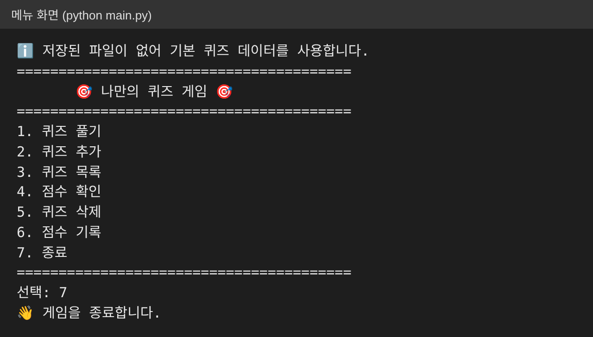
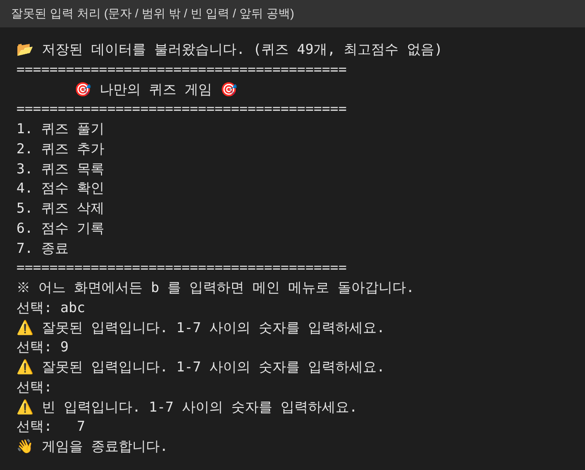
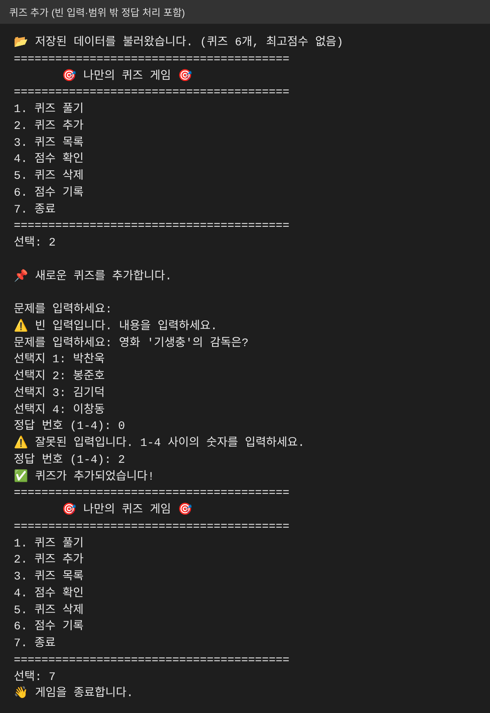
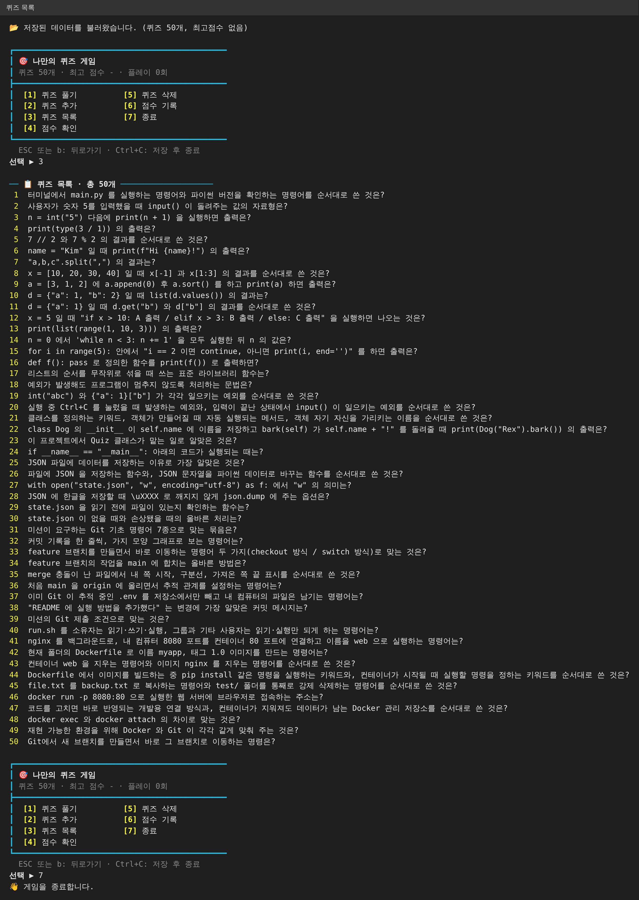
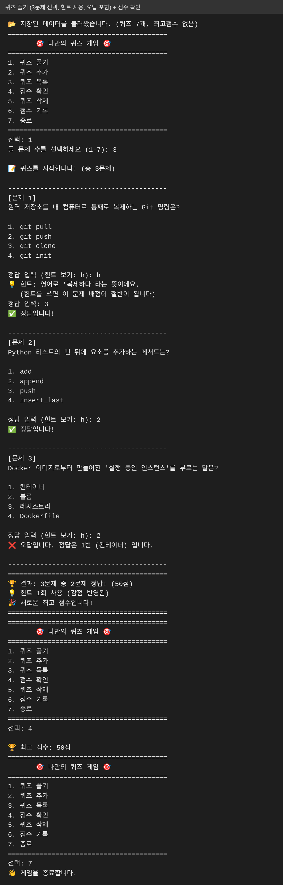
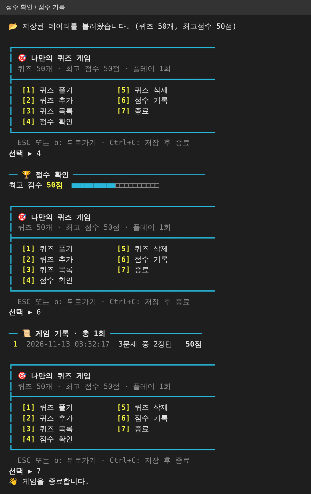
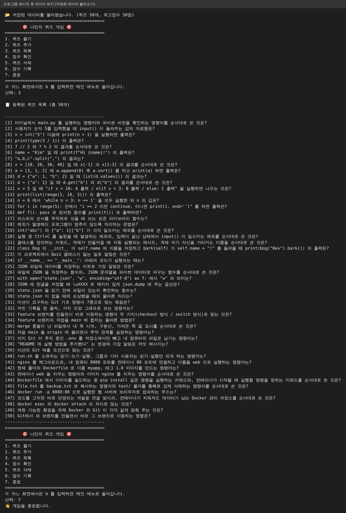
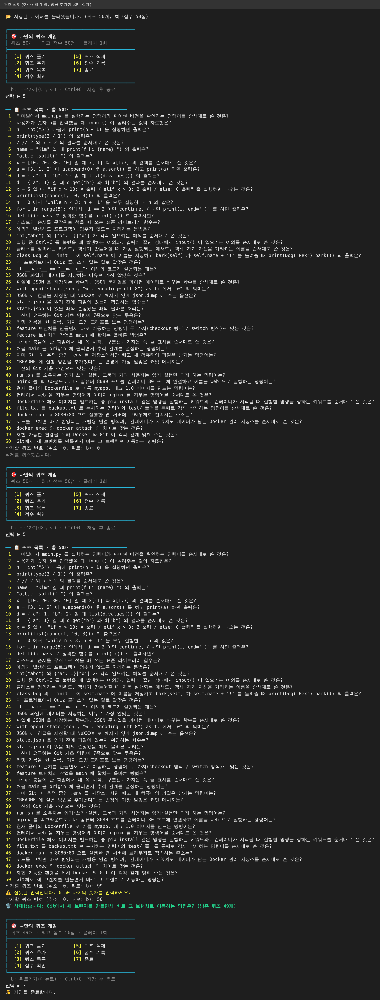
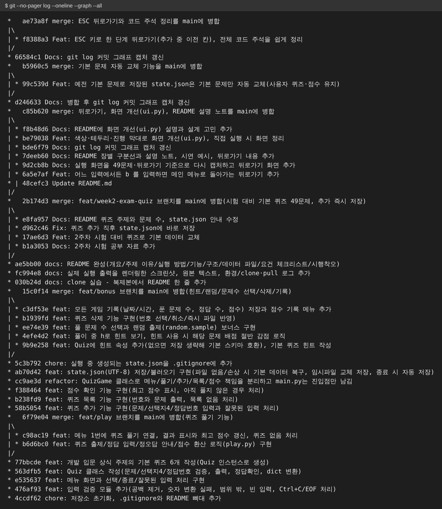

# 🎯 나만의 퀴즈 게임 (E1-2)

터미널에서 동작하는 **Python 콘솔 퀴즈 게임**입니다. 메뉴에서 번호를 고르면 퀴즈 풀기/추가/목록/점수 확인/삭제/기록이 동작하고,
프로그램을 종료해도 **추가한 퀴즈와 최고 점수가 `state.json`에 남습니다.**
이 문서만 읽어도 "무엇을, 왜, 어떻게 만들고, 어떻게 확인했는지" 따라올 수 있도록 순서대로 정리했습니다.

## 목차
1. [프로젝트 개요](#1-프로젝트-개요) · 2. [퀴즈 주제 선정 이유](#2-퀴즈-주제-선정-이유) · 3. [실행 방법](#3-실행-방법) · 4. [기능 목록](#4-기능-목록)
5. [파일 구조](#5-파일-구조) · 6. [데이터 파일(state.json)](#6-데이터-파일-statejson-설명) · 7. [코드 설계](#7-코드-설계-클래스와-함수) · 8. [입력/예외 처리](#8-입력예외-처리)
9. [실행 화면](#9-실행-화면) · 10. [Git 작업 과정](#10-git-작업-과정) · 11. [요건 충족 체크리스트](#11-요건-충족-체크리스트) · 12. [시행착오](#12-시행착오와-해결) · 13. [개념 정리](#13-배운-개념-정리-과제-목표-자기-점검)

## 1. 프로젝트 개요
- **목표:** Python 기본 문법(입출력, 조건, 반복, 함수, 클래스, 파일 입출력, 예외 처리)으로 동작하는 프로그램을 처음부터 끝까지 직접 만들고, Git으로 기능 단위 이력을 남긴다.
- **개발 환경:** Python 3.10 이상, **외부 라이브러리 없이 표준 라이브러리만 사용** (`json`, `os`, `random`, `datetime`, `pathlib`). 사용 버전은 [`docs/logs/env.log`](docs/logs/env.log) 참고.
- **보너스(5개 모두 구현):** 랜덤 출제, 문제 수 선택, 힌트(+감점), 퀴즈 삭제, 점수 기록 히스토리.

## 2. 퀴즈 주제 선정 이유
주제는 **「2주차 시험 대비 (Python · 예외 · 클래스 · JSON · Git · Docker 복습)」** 입니다.
1. 2주차 시험 공부 자료([`docs/week2_study.md`](docs/week2_study.md))의 개념마다 한 문제씩 만들어, 퀴즈를 풀면서 시험 범위를 복습할 수 있습니다.
2. 정답이 자료에 분명히 나와 있어 4지선다로 만들기 좋습니다.
3. 문제마다 힌트를 "동료에게 말로 설명할 때 쓸 한 문장"으로 써서, 동료평가 때 설명 연습도 됩니다.
4. 기본 49문제 외에 사용자가 자기 주제 퀴즈를 직접 추가할 수 있어, 다른 주제로도 확장됩니다.

## 3. 실행 방법
```bash
git clone https://github.com/kwork0828/E1-2.git
cd E1-2
python main.py        # Windows는 python, macOS/Linux는 python3
```
- 처음 실행하면 `state.json`이 없으므로 기본 퀴즈 49개로 시작하고, 종료할 때 `state.json`이 자동 생성됩니다.
- 예전에 실행해서 `state.json`이 이미 있으면 프로그램이 기본 데이터 대신 그 파일을 읽습니다. 새 기본 문제로 다시 시작하려면 `state.json`을 지우고(또는 이름을 바꾸고) 실행하세요. (이전 최고 점수와 기록도 함께 사라집니다.)
- 입력을 끝내고 싶을 때는 메뉴 `7. 종료` 또는 `Ctrl+C`(비정상 종료가 아니라 저장 후 안전 종료됩니다).

## 4. 기능 목록
| 메뉴 | 기능 | 핵심 동작 |
|---|---|---|
| 1 | 퀴즈 풀기 | 풀 문제 수 선택 → **랜덤** 순서로 출제 → 정답 입력 → 정오답 안내 → 결과/최고 점수 갱신 (`h` 입력 시 **힌트**, 그 문제 배점 절반) |
| 2 | 퀴즈 추가 | 문제, 선택지 4개, 정답 번호(1~4) 입력 → **추가 즉시** 파일에 저장 |
| 3 | 퀴즈 목록 | 등록된 퀴즈를 번호와 함께 표시 (없으면 안내) |
| 4 | 점수 확인 | 저장된 **최고 점수** 표시 (아직 안 풀었으면 안내) |
| 5 | 퀴즈 삭제 | 번호로 삭제, 0은 취소, 즉시 파일 반영 |
| 6 | 점수 기록 | 모든 게임의 날짜/시간, 푼 문제 수, 정답 수, 점수 |
| 7 | 종료 | 저장 후 종료 |

**점수 규칙:** 문제당 배점 = 100 ÷ 푼 문제 수. 힌트를 보고 맞히면 그 문제는 절반만 받습니다. 최종 점수는 반올림한 100점 만점이라 푼 문제 수가 달라도 최고 점수를 서로 비교할 수 있습니다.

## 5. 파일 구조
```text
E1-2/
├── main.py            # 진입점: 저장된 데이터를 불러와 게임 실행
├── quiz.py            # Quiz 클래스 (퀴즈 1개: 문제/선택지4/정답/힌트)
├── quiz_game.py       # QuizGame 클래스 (메뉴, 풀기/추가/목록/점수/삭제/기록, 저장/불러오기)
├── inputs.py          # 입력 검증 함수 (ask, ask_text, ask_int) + QuitGame 예외
├── default_data.py    # 기본 퀴즈 49개: 2주차 시험 대비 (Quiz 인스턴스로 생성)
├── state.json         # (실행 시 자동 생성, git 제외) 퀴즈 + 최고 점수 + 기록
├── tools/make_screenshots.py   # 실제 실행 화면을 PNG로 만드는 도구
├── docs/screenshots/  # 실행 화면 PNG        ├── docs/demo/   # 같은 화면의 원본 텍스트
└── docs/logs/         # 환경/clone·pull 실습 로그
```

## 6. 데이터 파일 (`state.json`) 설명
- **경로:** 프로젝트 루트 `state.json` (코드 위치 기준이라 어느 폴더에서 실행해도 같은 파일)
- **역할:** 프로그램을 종료해도 퀴즈와 최고 점수가 남도록 하는 저장소 (UTF-8, 한글 그대로 저장)
- **스키마:**

| 키 | 타입 | 설명 |
|---|---|---|
| `quizzes` | list | 퀴즈 목록. 각 항목은 `question`(str), `choices`(str 4개 리스트), `answer`(int, **1~4 번호**), `hint`(선택, str) |
| `best_score` | int 또는 null | 최고 점수(0~100). 아직 안 풀었으면 `null` |
| `history` | list | 보너스. `played_at`, `total`, `correct`, `score` (예전 파일처럼 이 키가 없어도 읽힘) |

```json
{
  "quizzes": [
    {"question": "Python의 창시자는?", "choices": ["Guido van Rossum", "Linus Torvalds", "Bjarne Stroustrup", "James Gosling"], "answer": 1, "hint": "네덜란드 출신 프로그래머입니다. 이름이 G로 시작해요."}
  ],
  "best_score": 50,
  "history": [{"played_at": "2026-11-07 07:05:36", "total": 3, "correct": 2, "score": 50}]
}
```
- **왜 JSON인가:** 리스트/딕셔너리 구조가 그대로 파일이 되고, 사람이 읽고 고칠 수 있으며, Python 표준 `json` 모듈만으로 충분합니다.
- **`state.json`을 git에 올리지 않는 이유:** 실행하면 계속 바뀌는 사용자 데이터라 커밋이 지저분해지기 때문입니다. 파일이 없으면 기본 데이터로 시작하므로 재현에는 문제가 없습니다.
- **안전 저장:** 임시 파일에 먼저 쓰고 `os.replace`로 교체합니다. 저장 도중 끊겨도 원본이 반쯤 쓰인 채 깨지지 않습니다.

## 7. 코드 설계 (클래스와 함수)
| 클래스/모듈 | 책임 |
|---|---|
| `Quiz` | 퀴즈 1개의 **데이터와 규칙** (선택지 4개·정답 1~4 검증, `show()`, `is_correct()`, `to_dict()`/`from_dict()`) |
| `QuizGame` | **게임 전체 진행**: 메뉴, 각 기능 메서드(`play`, `add_quiz`, `show_list`, `show_score`, `delete_quiz`, `show_history`), 파일 `save()`/`load()`, 실행 루프 `run()` |
| `inputs.py` | **입력 검증**을 한 곳에 모음. 모든 메뉴/숫자 입력이 같은 규칙으로 동작 |

한 함수에 몰아 쓰지 않고 *입력 처리 / 게임 진행 / 저장 로직*을 메서드로 분리했습니다. `__init__`의 `self`는 "이 객체 자신"이고, 각 `Quiz` 객체가 자기 문제·선택지·정답을 속성으로 들고 있습니다.

## 8. 입력/예외 처리
| 상황 | 처리 |
|---|---|
| 입력 앞뒤 공백 (`" 1 "`) | `strip()`으로 제거 후 처리 |
| 숫자 변환 실패 (`abc`) | 안내 후 **재입력** (`try/except ValueError`) |
| 범위 밖 숫자 (메뉴 9, 정답 0) | 안내 후 재입력 |
| 빈 입력 (그냥 Enter) | 안내 후 재입력 |
| `Ctrl+C` / 입력 스트림 종료(EOF) | `QuitGame` 예외로 받아 안내 → **저장 후 안전 종료** (트레이스백 없음) |
| `state.json` 없음 (첫 실행) | 기본 퀴즈 49개로 시작 |
| `state.json` 손상/형식 오류 | 안내 후 손상 파일을 `state.json.corrupt`로 백업, 기본 데이터로 **복구** |
| 퀴즈가 하나도 없음 | 풀기/목록/삭제에서 안내 |
| 아직 퀴즈를 안 풀고 점수 확인 | 안내 |

## 9. 실행 화면
 
**메뉴**


**잘못된 입력 처리** (문자 / 범위 밖 / 빈 입력 / 앞뒤 공백)


**퀴즈 추가**


**퀴즈 목록**


**퀴즈 풀기** (3문제 선택·랜덤·힌트·오답 포함) 와 점수 확인


**점수 확인 / 점수 기록**


**프로그램 재시작 후 데이터 유지**


**퀴즈 삭제**


## 10. Git 작업 과정
**커밋 규칙:** `feat`(기능) / `fix`(수정) / `docs`(문서) / `refactor`(구조 정리) / `chore`(설정) / `merge`(병합) + 한 줄 변경 요약. 기능 하나가 끝날 때마다 커밋했습니다.

**기본 명령어 7종 사용 기록**
| 명령 | 사용한 곳 |
|---|---|
| `git init` | 로컬 저장소 생성 (`git init -b main`) 후 `git remote add origin` |
| `git add` | 파일을 스테이징하고 커밋 (모든 커밋) |
| `git commit` | 기능 단위 커밋 |
| `git push` | 처음 `git push -u origin main`, 이후 브랜치/병합 결과 푸시 |
| `git checkout` | `git checkout -b feat/play`, `git checkout -b feat/bonus`, `git checkout main` |
| `git clone` | 별도 디렉토리에 복제 ([`docs/logs/clone-pull.log`](docs/logs/clone-pull.log)) |
| `git pull` | 복제본에서 푸시한 변경을 기존 디렉토리로 가져옴 (같은 로그) |
| `git merge --no-ff` | 브랜치 이력이 남도록 `feat/play`, `feat/bonus`를 main에 병합 |

**브랜치 전략:** 큰 기능 덩어리마다 브랜치를 따서 작업하고 `--no-ff`로 병합해 "여기서 갈라져 여기서 합쳐졌다"는 흔적을 남겼습니다.
- `feat/play`: 퀴즈 풀기 → main 병합
- `feat/bonus`: 힌트, 랜덤/문제 수 선택, 삭제, 기록 → main 병합
- `feat/week2-exam-quiz`: 기본 퀴즈를 2주차 시험 대비 49문제로 교체, 퀴즈 추가 즉시 저장 → main 병합

**실제 커밋 그래프** (`git --no-pager log --oneline --graph --all`, 마지막 문서 커밋 직전 기준)


## 11. 요건 충족 체크리스트
| 구분 | 요건 | 충족 | 근거 |
|---|---|---|---|
| 퀴즈 게임 | 메뉴 선택 → 출제/등록/목록/점수/종료 | ✅ | 9장 화면, `QuizGame.run` |
| | 퀴즈 풀기/추가/목록/점수 확인 동작 | ✅ | 4장 표, 9장 화면 |
| | 주제 퀴즈 5개 이상 | ✅ | `default_data.py` 49개 |
| | 종료 후 재실행해도 퀴즈·최고 점수 유지 | ✅ | 9장 "재시작" 화면, `state.json` |
| 코드 구조 | 클래스 2개 이상 | ✅ | `Quiz`, `QuizGame` |
| | 기능별 메서드/함수 분리 | ✅ | 7장 표 |
| | `state.json` 루트, UTF-8 | ✅ | `quiz_game.py`의 `STATE_PATH`, `encoding="utf-8"` |
| 입력/예외 | 공백 제거, 변환 실패, 범위 밖, 빈 입력 | ✅ | `inputs.ask_int`, 9장 "잘못된 입력" |
| | Ctrl+C/EOF 비정상 종료 방지 | ✅ | `QuitGame`, `finally: save()` |
| | 파일 없음/손상 시 실행 가능 | ✅ | `QuizGame.load` (8장 표) |
| Quiz 클래스 | 속성 question/choices/answer, 선택지 4개, 정답 1~4 | ✅ | `quiz.py` |
| | 출력·정답 확인 메서드 | ✅ | `show`, `is_correct` |
| QuizGame | 메뉴/풀기/추가/목록/점수/저장·불러오기 메서드 | ✅ | `quiz_game.py` |
| Git | 저장소 생성, `.gitignore`, `README.md`, 첫 commit/push | ✅ | 10장 |
| | 10개 이상 의미 있는 커밋 (기능 단위, 요약 포함) | ✅ | 10장 그래프 |
| | 브랜치 생성/병합 기록 | ✅ | `feat/play`, `feat/bonus` |
| | clone·pull 각 1회 이상 | ✅ | `docs/logs/clone-pull.log` |
| | 기본 명령 7종 각 1회 이상 | ✅ | 10장 표 |
| README | 개요/주제 이유/실행 방법/기능 목록/파일 구조/데이터 파일 | ✅ | 1~6장 |
| 제출물 | 저장소 URL | ✅ | https://github.com/kwork0828/E1-2 |
| | `git log --oneline --graph` 스크린샷 | ✅ | 10장 |
| | 실행 결과 스크린샷 (추가/목록/플레이/점수) | ✅ | 9장 (**터미널 출력을 PNG로 렌더링한 것**) |
| | 개발 환경 설정 스크린샷 (VSCode, Python 버전, Git 설정) | ⚠️ 부분 | 
| 보너스 | 랜덤 / 문제 수 선택 / 힌트+감점 / 삭제 / 기록 | ✅ | 4장 표 |
 

## 12. 시행착오와 해결
| # | 문제 | 원인 | 해결 |
|---|---|---|---|
| 1 | 정답 번호를 0부터 셀지 1부터 셀지 헷갈림 | 파이썬 리스트 인덱스는 0부터, 사용자 화면은 1부터 | 저장/입력 모두 **1~4 번호로 통일**, 선택지를 꺼낼 때만 `answer - 1` |
| 2 | 힌트 때문에 입력이 숫자가 아닐 수 있음 | `ask_int`가 숫자만 받도록 설계됨 | `allow=("h",)` 인자로 특정 문자만 예외 허용 |
| 3 | 퀴즈를 모두 삭제하면 "손상"으로 오인될까 우려 | 빈 리스트도 유효한 상태 | 빈 `quizzes`는 정상으로 취급, 형식 오류만 복구 |
| 4 | 문제 수가 달라 점수 비교가 애매 | 정답 개수로 비교하면 불공정 | 100점 만점 환산 점수를 `best_score`로 저장 |
| 5 | 화면 캡처 도구에서 입력값이 화면에 안 보임 | 파이프 입력은 터미널처럼 에코되지 않음 | `input()`을 "입력값을 다시 출력"하는 래퍼로 감쌈 (로직은 그대로) |
| 6 | 캡처 정답 입력이 랜덤 출제와 어긋날 위험 | 시드/퀴즈 개수가 다르면 뽑히는 문제가 달라짐 | 시드 고정 + 같은 상태(7개)로 정답을 계산 |

## 13. 배운 개념 정리 (과제 목표 자기 점검)
| 개념 | 이 프로젝트에서 |
|---|---|
| 변수 | 점수, 정답 수를 담는 이름표 (`correct`, `earned`) |
| `int`/`str`/`bool`/`list`/`dict` | 정답 번호 `int`, 문제 `str`, 선택지 `list`, 퀴즈 저장 형태 `dict`, 정답 여부 `bool` |
| `if/elif/else` | 정답/오답 분기, 입력 검증 |
| `for` vs `while` | 정해진 횟수(문제 순회)는 `for`, 올바른 입력이 올 때까지 반복은 `while True` |
| 함수 | 매개변수(`ask_int(prompt, low, high)`)로 받고 반환값으로 돌려줌 |
| 클래스/`__init__`/`self` | `Quiz`가 데이터+동작을 묶음, 각 객체가 자기 속성을 가짐 |
| 파일 입출력/JSON | `open(..., encoding="utf-8")` + `json.dump/load`로 영속성 확보 |
| `try/except` | 숫자 변환 실패, 파일 손상, Ctrl+C 처리 |
| Git | init(생성), add(스테이징), commit(기록), push(업로드), pull(가져오기), checkout(브랜치 이동/생성), clone(복제) |
